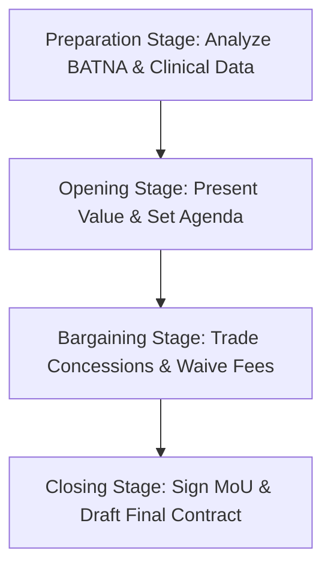
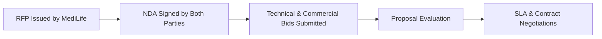
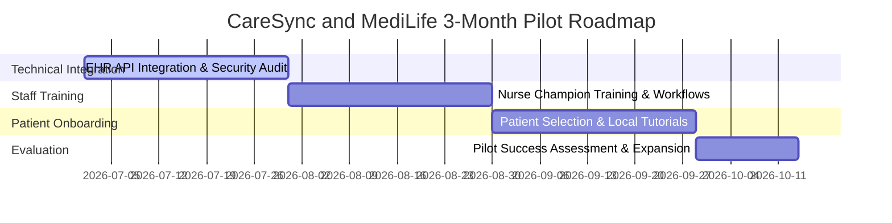

# Strategic Partnership Proposal: CareSync and MediLife Network

## LO1: Evaluating the Context and Preparation for Negotiation

### P1: Conceptual Definition and Stakeholder Identification

A negotiation is a structured communication process where two or more parties with different needs and goals work together to find a mutually acceptable agreement (Castle, 2018). In a business environment, negotiation occurs because organizations have mutual dependencies but differing priorities. For example, in the partnership between CareSync and MediLife Network, CareSync wants to sell its remote patient monitoring technology at a sustainable price and secure a long-term contract, while MediLife Network wants to modernize its operations at the lowest possible cost. Negotiation is necessary here to align these different interests and create a win-win partnership where both companies can benefit.

The key stakeholders in this negotiation process represent both technical and commercial roles. From CareSync, the Chief Executive Officer guides the strategic vision and ensures the partnership aligns with long-term business goals. The Sales Manager leads the commercial discussion, focusing on licensing fees and contract terms. The Technical Lead explains the software architecture and integration capabilities. The Healthcare Consultant provides clinical data and demonstrates patient outcomes. From MediLife Network, the Chief Medical Officer focuses on clinical safety and patient recovery rates. The Information Technology Manager is concerned with data security and system integration. The Operations Manager evaluates the impact on staff workload and hospital workflows. The Finance Manager evaluates the project costs and return on investment.

[Image Search Prompt: A professional meeting room in Tashkent, Uzbekistan, showing business professionals from CareSync and MediLife Network sitting around a modern conference table discussing a digital healthcare partnership, with a projector screen in the background displaying patient health monitoring analytics.]

---

### P2: Process and Key Considerations for Deal Generation

Generating a successful business deal requires a structured approach that moves from initial preparation to final agreement. Organizations must follow a sequence of steps to ensure all terms are mutually understood and value is maximized (Voss and Raz, 2017). The process begins with preparation, moves to opening presentations, proceeds through active bargaining, and concludes with a formal closing.

During these steps, negotiators must keep several key considerations in mind. First, they must understand the interests of the other party rather than just their stated demands. For instance, if MediLife demands a lower price, their real interest may be reducing the financial risk of adopting new technology. Second, negotiators must establish a clear Best Alternative to a Negotiated Agreement, which helps them know when to walk away from a bad deal. Third, they must focus on objective criteria, such as clinical trial data and industry standards, to justify their proposals rather than relying on emotional arguments.

---

### M1: Detailed Steps of Organizational Negotiations

The first stage is the preparation stage. In this phase, CareSync collects data from its past pilot programs to show how its AI-powered remote monitoring platform reduces emergency room visits. This preparation allows the Sales Manager to establish a realistic pricing range and set a clear walk-away point. The team also researches MediLife's current infrastructure to anticipate integration challenges.

The second stage is the opening stage. During this stage, both parties meet to present their initial positions and set the agenda. CareSync opens the negotiation by presenting a high-level overview of its platform, focusing on how it can help MediLife transition to a preventive care model. MediLife responds by stating its budgetary limits and its requirement for complete patient data privacy.

The third stage is the bargaining stage. This is where active trading of concessions occurs. For example, when MediLife’s Finance Manager objects to the software setup fee, CareSync proposes to waive the initial setup fee in exchange for a longer three-year contract commitment. This concession reduces MediLife’s short-term costs while securing long-term revenue for CareSync.

The fourth stage is the closing stage. In this final phase, the negotiators summarize the agreed terms and draft a written agreement. For CareSync and MediLife, this involves signing a Memorandum of Understanding that outlines the pilot program scope, pricing structures, and implementation timelines. This document is then sent to the legal teams of both companies to prepare the final contract.

---

### D1: Critical Evaluation of Negotiation Stages and Issue Mitigation

Although a structured negotiation process provides a clear roadmap, several issues can arise at each stage. In the preparation stage, teams often fail because of information gaps regarding the other party's budget or technical systems. To solve this, CareSync can conduct pre-negotiation meetings with MediLife’s IT staff to clarify their technical environment before the formal negotiations begin.

In the bargaining stage, the most common issue is a deadlock, where both parties refuse to change their positions on key terms like pricing or data ownership. For example, MediLife may refuse to pay a subscription fee per patient, while CareSync cannot afford a flat-rate license. To solve a deadlock, negotiators should use integrative bargaining techniques, which focus on expanding the value pool rather than arguing over a fixed price. CareSync can propose a risk-sharing model where the subscription price is linked to the actual reduction in patient readmission rates. This aligns the financial interests of both companies and breaks the deadlock.

During the closing stage, parties often experience buyer’s remorse or try to renegotiate terms at the last minute. This issue can be mitigated by documenting every agreement in writing at the end of each session. Using detailed minutes of meetings signed by both sides ensures that no party can easily reopen settled discussions during the final contract drafting.

---

### D2: Critical Evaluation of Tendering, Contracts, and Risk Mitigation

Competitive tendering is a procurement process where organizations invite multiple suppliers to submit bids for a project. For MediLife, this process allows them to compare different health-tech solutions and select the partner that offers the best balance of quality and price. However, competitive tendering introduces significant risks for both the buyer and the bidder.

For CareSync, the primary risk of tendering is the high cost of bid preparation with no guarantee of winning the contract. To mitigate this risk, CareSync must establish a strict qualification process to evaluate if a tender is worth pursuing. They must analyze the evaluation criteria, such as the thirty percent weight given to patient impact and the twenty percent weight given to technology integration. If CareSync cannot meet the basic technical requirements, they should withdraw early to save resources.

Another major risk is underestimating the cost of integration, which can lead to financial losses after the contract is signed. To prevent this, CareSync should include clear technical assumptions in its tender response. For example, the proposal should state that CareSync’s integration cost is based on MediLife using standard Electronic Health Record APIs. If MediLife uses a custom database system, the contract must allow for additional integration fees. This protects CareSync from unexpected technical workloads and financial risks.

---

## LO2: Managing Information and Documentation Relevant to Tenders and Contracts

### P3: Request for Proposal (RFP) Process and Key Documentation

The Request for Proposal process is a structured procurement method used by organizations to invite vendor solutions for a specific business need. The process begins when the buyer issues the RFP document, which describes the technical requirements, budget, evaluation criteria, and submission deadlines. Vendors then analyze the RFP, prepare their bids, and submit them for evaluation. The buyer reviews the proposals, selects the preferred vendor, and enters into final contract negotiations.

The RFP process requires several key documents to manage information and protect both parties. The RFP document itself contains the detailed project scope and technical specifications. The Non-Disclosure Agreement is signed before sharing any sensitive data, ensuring that CareSync's proprietary AI algorithms and MediLife's system details remain confidential. The technical proposal describes the software architecture, clinical use cases, and security compliance. The commercial proposal outlines the pricing models, licensing fees, and implementation costs. Finally, the Service Level Agreement defines the expected performance metrics, such as system uptime and support response times.

---

### P4: Contractual Process and Document Management

The contractual process begins once a proposal is selected and involves drafting, reviewing, negotiating, and signing the legally binding agreement. After the contract is signed, the management phase begins, which includes monitoring performance and updating terms as needed. Managing these documents requires systematic control to prevent legal disputes and service failures.

To manage and monitor contractual documentation, organizations use digital contract management systems. These systems provide version control, ensuring that all parties negotiate using the latest draft. They also set automated alerts for critical contract milestones, such as renewal dates, software updates, and security audit schedules. Access control is implemented to ensure that only authorized personnel can view sensitive patient data structures or pricing terms. Performance reports are generated monthly to match actual system performance against the SLAs defined in the contract.

---

### M2: RFP Context, Key Deliverables, and Consequences of Breach

In the context of the partnership between CareSync and MediLife, the RFP process acts as the formal bridge between CareSync’s technology and MediLife’s clinical network. CareSync must deliver a complete package of documents to ensure compliance. The key deliverables include a detailed data migration plan, an information security certification, and a custom integration roadmap for MediLife’s clinics. The data migration plan must explain how patient data will be moved from MediLife’s legacy systems to CareSync's cloud platform without data loss or service disruption.

Breaching the terms of the agreement can lead to severe operational and legal consequences for both organizations. If CareSync fails to maintain the agreed ninety-nine percent system uptime, MediLife’s doctors will lose access to real-time patient alerts, which can lead to delayed medical care and patient risk. Legally, such a breach activates the penalty clauses in the contract, requiring CareSync to pay financial compensation for every hour of downtime. In extreme cases, repeated SLA breaches allow MediLife to terminate the three-year contract immediately without paying any exit fees. Furthermore, a breach of patient data privacy can result in heavy government fines and permanent damage to CareSync’s reputation in the healthcare sector.

---

## LO3: Developing a Pitch to Achieve a Sustainable Competitive Edge

### P5: Pitching Principles and Value Proposition Formulation

A business pitch is a persuasive presentation designed to convince potential partners or investors to support a business proposal (Coghter, 2016). To achieve a sustainable competitive advantage, a pitch must clearly explain the unique value of the solution and why competitors cannot easily copy it. The pitch must focus on solving the specific problems of the client rather than just listing software features.

CareSync’s value proposition is built on three main pillars. First, the platform improves patient outcomes by using predictive AI to identify early signs of chronic disease deterioration, which reduces emergency hospital visits. Second, it improves operational efficiency by automating patient monitoring and reducing the workload of hospital nurses. Third, it ensures absolute data security by using advanced encryption standards that comply with international healthcare regulations. This combination of clinical effectiveness, cost reduction, and security compliance provides a strong value proposition that makes it difficult for traditional competitors to compete.

---

### M3 & D3: Structured, Creative, and Persuasive Pitch Delivery Strategy

A structured pitch must follow a clear narrative arc to keep the audience engaged. The presentation begins with a compelling hook, presents the problem, details the solution, provides clinical evidence, explains the business model, and ends with a clear call to action (Cremades, 2016). For the MediLife decision-makers, CareSync’s pitch is designed to address the specific interests of each stakeholder in the room.

The pitch begins with a real-life scenario of an elderly patient in Samarkand who has chronic heart disease. Without remote monitoring, the patient only visits the clinic when a crisis occurs, leading to expensive emergency stays. This scenario highlights the problem of reactive healthcare, which increases operational costs and reduces patient survival rates. CareSync then presents its solution, demonstrating how a wearable device automatically alerts the MediLife clinic when the patient's heart rate changes, allowing for early intervention.

[Image Search Prompt: A professional digital mock-up of the CareSync remote patient monitoring system, showing a clean dashboard on a tablet with real-time heart rate graphs, patient health alerts, and AI-driven clinical risk summaries for a doctor in a modern clinic environment.]

To persuade the Chief Medical Officer, the presentation highlights data from a pilot program showing a twenty-five percent reduction in hospital readmissions for heart patients. For the IT Manager, the Technical Lead shows that CareSync uses standard integration protocols, which allows the platform to connect with MediLife’s existing EHR system in less than thirty days. For the Operations Manager, the pitch explains how the automated alert system filters out false alarms, saving nurses up to two hours of administrative work per shift. Finally, for the Finance Manager, CareSync presents a cost-benefit analysis demonstrating that the platform will pay for itself within the first twelve months by reducing empty hospital beds and optimizing staff schedules. The pitch closes with a proposal for a risk-free three-month pilot program in two selected clinics to prove these results in MediLife's own environment.

---

## LO4: Assessing the Outcome of a Pitch and Negotiation

### P6: Defining Success Indicators for Pitch Outcomes

Assessing the outcome of a pitch and negotiation requires establishing clear, measurable success indicators before the meetings begin. These indicators help both teams evaluate whether the final agreement meets their strategic and financial goals. Success cannot be judged solely on whether a contract is signed; it must also consider the quality of the commercial terms.

The success indicators for CareSync are divided into commercial, technical, and clinical categories. Commercially, success is defined as securing a three-year contract with a minimum licensing fee that covers the deployment costs and provides a twenty percent profit margin. Technically, success means achieving agreement on a standardized API integration plan, which avoids custom software development. Clinically, the success indicator is the mutual agreement on a joint clinical committee that will monitor patient health outcomes during the partnership. For MediLife, success is defined as securing a volume discount on wearable devices and obtaining full training support for their medical staff at no extra cost.

---

### P7: Post-Pitch Obligations and Operational Bottlenecks

Once the pitch and negotiation are complete, both organizations must fulfill their post-pitch obligations to ensure a smooth transition to implementation. The signing of the contract is the beginning of an operational partnership. CareSync is obligated to deliver the monitoring software, configure the cloud servers, and provide training materials for the clinical staff. MediLife is obligated to assign project managers, provide technical access to their EHR databases, and select the clinical departments that will participate in the initial rollout.

Several operational bottlenecks can occur during this transition phase. The most common bottleneck is resistance from medical staff who are accustomed to traditional patient check-ups and feel overwhelmed by new digital tools. Doctors and nurses may view the remote alerts as extra work rather than an efficiency tool. Another bottleneck is technical incompatibility, where MediLife’s legacy databases require custom database mapping that was not anticipated during the negotiation. These issues can delay the project launch and increase costs if they are not managed proactively.

---

### M4 & D4: Post-Pitch Risk Management, Roadmap, and Recommendations

To manage the risks of the post-pitch transition, CareSync and MediLife must implement a phased implementation plan. A three-month pilot program is recommended to test the system in a controlled environment before rolling it out across all twenty clinics. This pilot program will focus on two major clinics, one in Tashkent and one in Samarkand, involving a limited group of one hundred chronic heart patients.

During the first month of the pilot, the technical teams will focus on EHR integration and security testing. To mitigate the risk of technical delays, CareSync will deploy a dedicated support engineer to work onsite at MediLife’s IT headquarters. In the second month, the focus shifts to staff training. To overcome staff resistance, CareSync will implement a champion program, training select senior nurses who can then support and encourage their colleagues. In the third month, patient onboarding begins. CareSync will provide simplified user guides and video tutorials in local languages to ensure elderly patients can easily use the wearable devices.

Success during the pilot will be evaluated using three main metrics. First, a clinical metric target of a fifteen percent reduction in emergency admissions among the pilot patient group. Second, an operational metric of a ninety percent user satisfaction rate among the participating nurses. Third, a technical metric of zero data transmission failures during the three-month period. Meeting these targets will trigger the automatic expansion of the contract to the remaining eighteen clinics, ensuring a low-risk, scalable path to full deployment.

---

## References and Bibliography

Castle, T., 2018. *The Art of Negotiation: How to get what you want, every time*. London: I_AM Self Publishing. Available at: https://www.amazon.com/Art-Negotiation-How-what-every/dp/1912635235

Coghter, P., 2016. *The Art of the Pitch: Persuasion and Presenting Skills that Win Business*. New York: Palgrave Macmillan. Available at: https://www.palgrave.com/gp/book/9781137278227

Cremades, A., 2016. *The Art of Startup Fundraising: Pitching Investors, Negotiating the Deal, and Everything Else Entrepreneurs Need to Know*. Hoboken: John Wiley & Sons. Available at: https://www.wiley.com/en-us/The+Art+of+Startup+Fundraising-p-9781119191766

Voss, C. and Raz, T., 2017. *Never Split the Difference: Negotiating As If Your Life Depended On It*. London: Random House Business. Available at: https://www.penguin.co.uk/books/299/299691/never-split-the-difference/9781473534940.html

World Health Organization, 2021. *Global strategy on digital health 2020-2025*. Geneva: World Health Organization. Available at: https://www.who.int/publications/i/item/9789240020924

